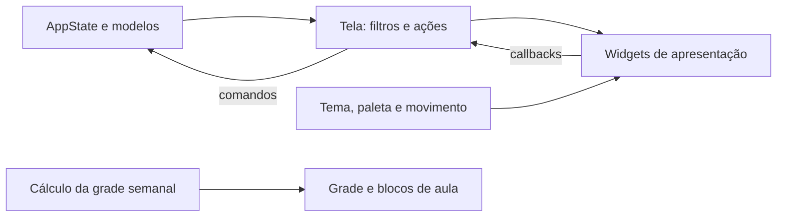

# Organização do código Flutter

O ponto de entrada inicializa o estado e configura as rotas. O cabeçalho, a navegação e o tema ficam em módulos próprios. As telas acadêmicas coordenam pesquisa, filtros e ações; os componentes recebem dados e callbacks para renderizar a interface.

```text
lib/
  main.dart                         Inicialização e rotas
  app/
    app_repositories.dart           Composição e injeção dos repositórios
    academic_navigation.dart        Destinos e navegação com curso/semestre/perfil
    app_shell.dart                  Cabeçalho, avisos e conteúdo das rotas
  core/
    api_client.dart                 Comunicação com a API
    data_source.dart                Seleção por DATA_SOURCE, local por padrão
    app_state.dart                  Estado, regras e coordenação de cache/backup
    models.dart                     Modelos acadêmicos
    theme/app_theme.dart            Tema global claro/escuro
  domain/repositories/              Interfaces de cursos, auth, administração,
                                    currículos, ementas, horários, feedback,
                                    extrações, migrações e armazenamento
  data/repositories/
    api/                            Implementações dos endpoints My UFAPE
    supabase/                       Dados acadêmicos diretos, auth e feedback
    local/                          Repositórios JSON e armazenamento local
  features/academic/
    academic_common.dart            Elementos compartilhados e detalhes
    academic_palette.dart           Cores acadêmicas e estados da matriz
    academic_motion.dart            Movimento reduzido e transições compartilhadas
    academic_context_menu.dart      Menus por mouse/teclado e controle do menu Web
    catalog_screen.dart             Busca e filtros do catálogo
    catalog/subject_card.dart        Cartão do catálogo
    matrix_screen.dart              Filtros, grafo interativo e ações de progresso
    matrix/
      subject_card.dart             Aparência e ações do cartão da matriz
      matrix_motion.dart            Entrada, pressão, hover e foco dos cartões
      node_layer.dart               Entrada, saída e reposicionamento do grafo
      period_navigation.dart        Atalhos de período e zoom em telas estreitas
      progress_summary.dart         Resumo, requisitos e campos de horas
      prerequisite_painter.dart     Desenho dos vínculos
      elective_editor.dart          Seleção e edição de optativas
    schedule_screen.dart            Ofertas, filtros, abas e exportação
    schedule/
      offering_card.dart            Seleção, conclusão e conflitos de uma oferta
      week_layout.dart              Partições de horários e identificação dos turnos
      week_grid.dart                Linhas, colunas e posicionamento da grade
      session_card.dart             Conteúdo de um bloco de aula
      export_card.dart              Documento da grade para salvar em PNG
      session_motion.dart           Entrada, saída e reposicionamento dos blocos
      badge.dart                    Etiquetas de período, horário e código
  features/admin/
    admin_navigation_guard.dart     Proteção de navegação com edição pendente
  services/widget_image.dart        Renderização de PNG independente da tela
```

## Responsabilidades

O acesso aos dados usa interfaces de repositório. `AppRepositories` injeta as implementações e cria um escopo de autenticação para cada tela administrativa. As responsabilidades, provedores e exemplos de substituição estão em [repositorios.md](repositorios.md).



Os cartões recebem dados e callbacks, sem acesso direto ao `AppState`. O resumo da matriz recebe progresso, perfil, horas e callbacks separados; apenas o campo de horas mantém o controller e o foco necessários à edição. A tela continua sendo responsável por abrir os detalhes, alterar status e chamar a persistência.

O cálculo de intervalos em `ScheduleWeekLayout` depende apenas dos modelos, sem importar Flutter. `ScheduleWeekGrid` converte esses intervalos em posições; `ScheduleSessionLayer` mantém temporariamente os blocos em saída, desativa suas interações e descarta os controllers ao terminar.

`academicMotionDuration` concentra a preferência de movimento reduzido e a navegação acessível. Durante a exportação, os horários também desativam as animações explicitamente. A paleta preserva as cores distintas de seleção da grade e de status da matriz.

`MatrixNodeLayer` preserva a identidade dos cartões que continuam nos resultados e mantém os cartões removidos apenas durante a saída, sem permitir cliques, foco ou leitura por acessibilidade. O crescimento das optativas respeita a altura final do conteúdo durante o reposicionamento. A entrada dos cartões tem um intervalo limitado a 96 ms, inclusive em matrizes grandes.

Os botões de zoom interpolam a transformação atual e acumulam comandos rápidos. Rodar a roda com Ctrl, iniciar uma pinça ou arrastar interrompe a interpolação e devolve o controle direto ao gesto. `AcademicFormSection` anima a abertura e o fechamento de campos, e `academicDialogMotion` centraliza as transições dos diálogos e dos detalhes.

`main.dart` mantém as exportações públicas anteriores de tema, cabeçalho e navegação para compatibilidade. As telas e os testes de componentes importam seus módulos diretamente; a página inicial deixou de depender do ponto de entrada.

## Como verificar

Na pasta `flutter/`:

```powershell
fvm flutter analyze
fvm flutter test
```

Para gerar as capturas de widgets usadas na comparação visual:

```powershell
fvm flutter test test/home_design_test.dart test/matrix_design_test.dart test/schedule_design_test.dart test/catalog_design_test.dart --dart-define=HOME_SCREENSHOTS=true --dart-define=MATRIX_SCREENSHOTS=true --dart-define=SCHEDULE_SCREENSHOTS=true --dart-define=CATALOG_SCREENSHOTS=true
```

As capturas incluem desktop, celular, paisagem, tema escuro e texto ampliado. A refatoração foi comparada com capturas registradas imediatamente antes dela; a igualdade de SHA-256 verifica que esses PNGs permaneceram idênticos. Esses comandos não geram builds de distribuição.
