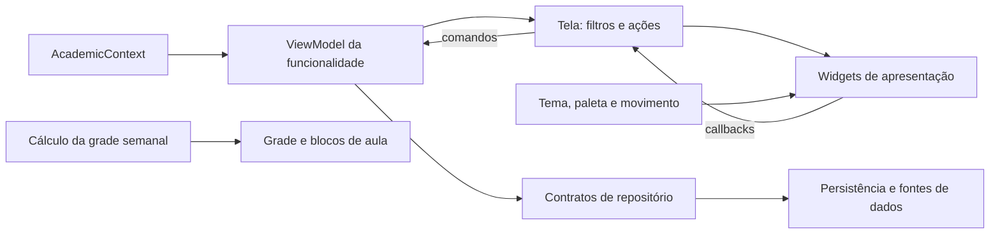

# Organização do código Flutter

O ponto de entrada inicializa as dependências e configura as rotas. O contexto acadêmico mantém a seleção e as definições publicadas. Cada tela tem View e ViewModel próprios; os componentes recebem dados e callbacks para renderizar a interface.

```text
lib/
  main.dart                         Inicialização e rotas
  app/
    app_repositories.dart           Seleção dos provedores de dados
    academic_navigation.dart        Destinos e navegação com curso/semestre/perfil
    app_shell.dart                  Cabeçalho, avisos e conteúdo das rotas
  core/
    api_client.dart                 Comunicação com a API
    data_source.dart                Seleção por DATA_SOURCE, local por padrão
    app_state.dart                  Composição, vida útil e fachada de compatibilidade
    academic_context.dart           Curso, semestre, perfil e definições publicadas
    models.dart                     Modelos acadêmicos
    theme/app_theme.dart            Tema global claro/escuro
  domain/repositories/              Interfaces de cursos, auth, administração,
                                    currículos, ementas, horários, feedback,
                                    extrações, migrações e armazenamento
  data/repositories/
    academic/                       Consulta acadêmica com cache e fallback local
    personal/                       Preferências, conclusões, progresso, grade e backup
    api/                            Implementações dos endpoints My UFAPE
    supabase/                       Dados acadêmicos diretos, auth e feedback
    local/                          Repositórios JSON e armazenamento local
  data/parsers/
    academic_course_parser.dart     Perfis, catálogo, ofertas e união com ementas
  domain/academic_rules.dart         Identidade, notas, optativas, progresso e conflitos
  features/
    home/
      home_view.dart
      home_view_model.dart
      widgets/                         Cabeçalho, atalhos, curso, módulos, calendário e rodapé
    academic/
      widgets/                         Componentes compartilhados da área acadêmica
      catalog/
        catalog_view.dart
        catalog_view_model.dart
        widgets/                       Filtros, seletores e cartão da disciplina
      matrix/
        matrix_view.dart
        matrix_view_model.dart
        widgets/                       Toolbar, legenda, lista compacta, cartões, progresso e grafo
      schedule/
        schedule_view.dart
        schedule_view_model.dart
        widgets/                       Painel de ofertas, períodos, grade semanal e exportação
    admin/
      admin_view.dart
      admin_view_model.dart
      widgets/                         Workspace, navegação, login, seções, editores e revisão
    calendar/
      calendar_view.dart
      calendar_view_model.dart
      widgets/                         Controles e visualizador com zoom e teclado
    feedback/
      feedback_view.dart
      feedback_view_model.dart
      widgets/                         Formulário e campos de mensagem/contato
    settings/
      settings_view.dart
      settings_view_model.dart
      widgets/                         Aparência, backup, fonte dos dados e diálogo de servidor
  app/admin_navigation_guard.dart      Proteção de navegação com edição pendente
  data/parsers/admin_data.dart         Normalização e validação dos dados administrativos
  services/widget_image.dart        Renderização de PNG independente da tela
```

Cada diretório de tela mantém sua View e ViewModel na raiz. Componentes visuais
específicos ficam em `widgets/`; componentes acadêmicos compartilhados ficam em
`features/academic/widgets/`. Parsers e guarda de navegação permanecem em
`data/parsers/` e `app/`, respectivamente.

## Responsabilidades

`AcademicContext` observa apenas a seleção acadêmica e o carregamento das
definições publicadas. `AppState` recebe os colaboradores e mantém delegações para
os consumidores anteriores, sem guardar estado próprio de matriz, grade ou tema.
As telas de matriz, horário e preferências observam seus ViewModels. A raiz do
aplicativo observa o tema em `SettingsViewModel`; editar uma nota ou selecionar
uma oferta não notifica as rotas nem reconstrói o `MaterialApp` por esse caminho.

`AcademicDataRepository` decide entre fonte configurada, cache e assets, e
`AcademicCourseParser` interpreta os formatos acadêmicos existentes.
`MatrixProgressRepository` restaura e persiste edições pessoais sem substituir
metadados oficiais. `CompletionRepository` compartilha conclusões por identidade
acadêmica entre perfis, enquanto `SchedulePlanRepository` mantém a seleção por
curso e semestre. Os contratos e implementações desses repositórios ficam juntos
em `data/repositories`, seguindo o mesmo tratamento de falhas por exceções já
usado pelo aplicativo.

`MatrixViewModel` observa contexto, conclusões e grade para preparar o progresso
e o status das disciplinas. `ScheduleViewModel` observa contexto e conclusões,
reconcilia a seleção com as ofertas atuais e remove as disciplinas concluídas.
Um ViewModel não depende do outro. `AcademicProgressCalculator` e
`ScheduleConflicts` são regras Dart sem widgets. Filtros visuais, controllers e
animações continuam nas telas.

`PersonalStorageRepository` mantém o snapshot pessoal e serializa as gravações.
`write`, `writeAll` e as gravações dos repositórios de progresso, conclusões e grade
retornam Futures aguardáveis. O adaptador de SharedPreferences rejeita operações
cujo retorno seja `false`, além de propagar exceções da plataforma. A confirmação
representa a conclusão aceita pela API de armazenamento da plataforma.

As edições comuns continuam otimistas. Falhas ficam registradas por chave e são
exibidas em `PersistenceBanner`, observado diretamente pela estrutura da aplicação,
sem notificar o contexto acadêmico. O aviso oferece uma nova tentativa e só
desaparece quando as gravações pendentes forem confirmadas. `retry()` reaplica o
valor mais recente de cada chave, incluindo exclusões, sem repetir ações como
adicionar optativas e sem mudar o curso ou semestre visível.

`flush()` aguarda a fila e propaga falhas sem consumi-las: chamar outra vez ou salvar
uma chave diferente não transforma uma edição rejeitada em sucesso. Importação e
limpeza de progresso e o diálogo de optativas aguardam essa confirmação antes de
informar sucesso ou fechar. Falhas têm mensagem explícita e preservam a intenção
de edição para nova tentativa.
`BackupRepository` mantém a lista de chaves permitidas e faz a migração legada em
um snapshot separado, sem criar outro `AppState` nem incluir cache e credenciais.
Falhas de armazenamento na importação geral são propagadas, distinguindo-as de
arquivos inválidos. O rollback preserva edições mais recentes e suas próprias
falhas também permanecem recuperáveis. A importação geral restaura preferências e
recarrega o contexto e a grade, mesmo
quando o curso e o semestre continuam iguais.

O `AppState` é o dono dos ViewModels e dos repositórios observáveis. Ao encerrar,
remove primeiro os listeners das features e depois descarta os repositórios e o
contexto. As páginas não descartam essas instâncias compartilhadas.

Os testes de `test/personal_persistence_test.dart` e
`test/shared_preferences_persistence_test.dart` verificam espera pelo dispositivo,
falhas persistentes, retorno booleano negativo, recuperação, exclusões, rollback,
isolamento por semestre e nova tentativa sem duplicar optativas. Os testes de
`test/state_ownership_test.dart` verificam isolamento das notificações,
sincronização entre grade e matriz, restauração no mesmo contexto, confirmação de
persistência e descarte durante a inicialização.

O acesso aos dados usa interfaces de repositório. `AppRepositories` injeta as implementações e cria um escopo de autenticação para cada tela administrativa. As responsabilidades, provedores e exemplos de substituição estão em [repositorios.md](repositorios.md).



Os cartões recebem dados e callbacks, sem acesso direto ao `AppState`. O resumo da matriz recebe progresso, perfil, horas e callbacks separados; apenas o campo de horas mantém o controller e o foco necessários à edição. A tela abre os detalhes e encaminha alterações de status ao ViewModel, que coordena os repositórios.

O cálculo de intervalos em `ScheduleWeekLayout` depende apenas dos modelos, sem importar Flutter. `ScheduleWeekGrid` converte esses intervalos em posições; `ScheduleSessionLayer` mantém temporariamente os blocos em saída, desativa suas interações e descarta os controllers ao terminar.

`academicMotionDuration` concentra a preferência de movimento reduzido e a navegação acessível. Durante a exportação, os horários também desativam as animações explicitamente. A paleta preserva as cores distintas de seleção da grade e de status da matriz.

`MatrixNodeLayer` preserva a identidade dos cartões que continuam nos resultados e mantém os cartões removidos apenas durante a saída, sem permitir cliques, foco ou leitura por acessibilidade. O crescimento das optativas respeita a altura final do conteúdo durante o reposicionamento. A entrada dos cartões tem um intervalo limitado a 96 ms, inclusive em matrizes grandes.

Os botões de zoom interpolam a transformação atual e acumulam comandos rápidos. Rodar a roda com Ctrl, iniciar uma pinça ou arrastar interrompe a interpolação e devolve o controle direto ao gesto. `AcademicFormSection` anima a abertura e o fechamento de campos, e `academicDialogMotion` centraliza as transições dos diálogos e dos detalhes.

`main.dart` mantém as exportações públicas anteriores de tema, cabeçalho e navegação para compatibilidade. As telas e os testes de componentes importam seus módulos diretamente; a página inicial deixou de depender do ponto de entrada.

## Como verificar

A tela inicial usa `HomeEntrance` para uma entrada em sequência dos blocos,
com fade e deslocamento discreto, encerrada em até 570 ms. As chaves mantêm o
estado da animação ao atualizar dados ou avisos da tela; tema e dados não devem
reiniciar a entrada. Os cartões reagem a hover e foco, com compressão curta no
clique e recuperação ao cancelar. Movimento reduzido e navegação acessível
desativam os deslocamentos. `test/home_motion_test.dart` verifica esses estados.

O hover da Matriz usa um notifier visual local, sem reconstruir a View, a
geometria do grafo ou o resumo de progresso. `MatrixHoverBuilder` observa apenas
mudanças de relação (ativo, pré-requisito, dependente ou sem relação) para cada
cartão. A camada de linhas anima separadamente e cartões usam `RepaintBoundary`.
A saída de um cartão é consolidada após a entrada no próximo, evitando limpar o
destaque entre cartões. `test/matrix_motion_test.dart` verifica a reutilização do
grafo, do resumo e dos cartões sem mudança visual durante o hover.
As curvas e suas métricas são preparadas ao mudar o destaque ou a geometria.
A animação das linhas usa o canal `repaint` do `CustomPainter`, reutilizando o
painter e os caminhos entre quadros. `test/matrix_prerequisite_layer_test.dart`
verifica essa reutilização, movimento reduzido e cores das relações desenhadas.

Em Horários, `ScheduleViewModel` prepara perfis, períodos e o índice de busca das
turmas. O índice normaliza os textos uma vez por alteração da oferta e reutiliza
o último resultado de filtro; as coleções expostas são somente leitura. Mudanças
na lista, inclusive substituição de itens no mesmo objeto, invalidam os dados
derivados. A View apenas consome essas opções. Os testes em
`test/schedule_view_model_test.dart` cobrem busca, filtros e invalidação.
O ViewModel agrupa notificações síncronas produzidas pela reconciliação entre
contexto, conclusões e planejamento. Os observadores recebem o estado final
uma vez, sem aguardar um frame ou microtask; alterações diretas no planejamento
continuam notificando imediatamente. Uma reconciliação que mantém as mesmas
turmas também evita regravar o planejamento.

`CatalogViewModel` depende apenas do contexto acadêmico, sem observar ou expor o
ViewModel da Matriz. Notas, conclusões e planejamento não notificam o Catálogo.
Perfis, períodos e textos normalizados de busca são preparados no ViewModel e
invalidados quando o catálogo muda. A regra de identificação de optativas do
catálogo fica em `Subject.isCatalogElective`, compartilhada pelos filtros e cards.
`test/catalog_view_model_test.dart` verifica o isolamento das notificações e a
combinação dos filtros.

Na pasta `flutter/`:

```powershell
fvm flutter analyze
fvm flutter test
```

Para gerar as capturas de widgets usadas na comparação visual:

```powershell
fvm flutter test test/home_design_test.dart test/matrix_design_test.dart test/schedule_design_test.dart test/catalog_design_test.dart --dart-define=HOME_SCREENSHOTS=true --dart-define=MATRIX_SCREENSHOTS=true --dart-define=SCHEDULE_SCREENSHOTS=true --dart-define=CATALOG_SCREENSHOTS=true
```

As capturas incluem desktop, celular, paisagem, tema escuro e texto ampliado. A refatoração foi comparada com capturas registradas imediatamente antes dela; a igualdade de SHA-256 verifica que esses PNGs permaneceram idênticos. Esses comandos não geram builds de distribuição.


## Edição administrativa de cursos

`CourseEditorViewModel` recebe `CourseRepository` por construtor e pertence ao
escopo da tela administrativa. Mantém seleção, rascunho de configurações,
currículo e horário, validação de registros/perfis/vínculos e baselines de cada
área. As leituras públicas do rascunho são snapshots somente leitura; a UI envia
comandos para alterá-lo.

Carregamento, salvamento e exclusão retornam `AsyncResult<Unit>`, com causa e stack
preservados em `AppException`. O baseline só avança após a confirmação da gravação;
edições feitas enquanto uma operação aguarda continuam pendentes. Se a criação
for confirmada mas a visibilidade falhar, a próxima tentativa atualiza o mesmo
curso. Falha ao reler a lista após um salvamento confirmado produz um aviso.
Respostas de carregamentos antigos e conclusões após descarte não substituem o
rascunho atual nem notificam listeners descartados.

`AdminRoute` cria e descarta o único `AdminViewModel` recebido por `AdminView`.
O ViewModel encapsula o editor, a sessão e os repositórios administrativos;
a View e seus widgets recebem dados e ações, sem acessar esses repositórios.
Controllers, filtros visuais, diálogos e navegação continuam na UI.
As confirmações administrativas usam `widgets/admin_confirmation_dialog.dart`.
A View impede confirmações sobrepostas e revalida operações em andamento após
o diálogo. Voltar e sair pela navegação principal passam pela mesma proteção.
Ao confirmar o descarte de notas antes de trocar de curso, o formulário de
feedback é reiniciado, mantendo seus campos consistentes com o descarte aceito.

Autenticação, configuração e extração são coordenadas pelo ViewModel. O polling
evita consultas simultâneas da mesma execução, preserva o último status em falhas
e encerra seu timer no descarte. Respostas de execuções anteriores ou posteriores
ao descarte não atualizam a tela. Falhas preservam causa e stack trace, e o token
permanece disponível para retomar uma extração interrompida.

O ViewModel prepara uma `AdminImportPreview` imutável, com validação, mesclagem e
comparação do currículo ou horário. A comparação inclui semestre e metadados da
extração. `widgets/admin_import_review_dialog.dart` exibe essa prévia; aplicar só
altera o rascunho, sem persistir. Se o curso ou o rascunho comparado mudar antes da
confirmação, a prévia deve ser refeita. Feedback e migrações usam callbacks do
ViewModel. O ViewModel mantém a lista imutável, o carregamento e as falhas dos
feedbacks; notas e seleção do formulário continuam no widget. Uma gravação
confirmada permanece aplicada mesmo quando a atualização da lista falha, com
aviso e opção de atualizar novamente. Consultas duplicadas são bloqueadas e
respostas após descarte são ignoradas.

A migração também é coordenada pelo `AdminViewModel`: inventário, seleção,
autorização de substituição, prévia, execução por curso, progresso e histórico.
Os snapshots são imutáveis e mudar a seleção invalida a prévia. A confirmação
do diálogo fica vinculada à mesma prévia validada, evitando executar uma seleção
alterada durante a confirmação. A execução bloqueia ações concorrentes e, após
descarte, não inicia a importação dos cursos restantes. A requisição já enviada
pode terminar no servidor. Falhas parciais são exibidas; falhar ao atualizar o
histórico preserva o resultado da execução. O widget mantém o diálogo de
confirmação e a exportação local do relatório.

`test/course_editor_view_model_test.dart` e `test/admin_view_model_test.dart`
verificam transições, concorrência, revisão de importações e falhas sem montar a
tela. Os testes administrativos de widgets verificam navegação, salvamento local
e o fluxo de revisar, cancelar e aplicar importações em largura de celular.


## Composição com AutoInjector

`config/dependencies.dart` centraliza os registros e chama `commit()` ao terminar.
`setupDependencies()` cria um container por aplicação, sem estado global. Os
contratos de armazenamento, dados acadêmicos, progresso, planejamento e backup,
o contexto acadêmico e os ViewModels são lazy singletons nesse container.
`AppRepositories` mantém a seleção local/API/Supabase e a troca dinâmica do
cliente de API; o container publica seus contratos sem fixar um cliente antigo.

`AppState` recebe as instâncias prontas e observa `AcademicContext`, sem ser sua
subclasse. Ele permanece no nível da aplicação para inicialização, sincronização
de rotas e ciclo de vida. As telas recebem diretamente seus ViewModels: Home,
Matriz, Horários e Configurações não dependem da fachada. `HomeViewModel` compõe o
contexto acadêmico e as preferências. A criação de `AppState` fica exclusivamente
em `config/dependencies.dart`, sem dependência reversa de `core` para `config`.

`main()` inicializa o armazenamento pessoal antes de `runApp`. `Bootstrap` mantém
a tela de preparação durante o carregamento acadêmico e é dono de
`AppDependencies`. O descarte encerra ViewModels, contexto, armazenamento e fontes
uma única vez, e só então libera os registros do injector.

`setupAdminDependencies()` cria um container independente por tela administrativa.
Autenticação, repositórios autorizados e `CourseEditorViewModel` pertencem a esse
escopo; duas sessões não compartilham JWT nem rascunho. A View remove seus listeners;
`AdminRoute` descarta o ViewModel, que encerra o polling e libera o escopo ao fechar.
No modo local, os repositórios de documentos públicos
e administrativos continuam compartilhando a base local, como antes.

`get<T>()` fica restrito à composição e às entradas de UI. Os repositórios e
ViewModels continuam com dependências explícitas no construtor. Os testes podem
injetar `AppRepositories` e `assetLoader` em `setupDependencies()`; não precisam
alterar um singleton global. `test/dependencies_test.dart` verifica resolução,
identidade compartilhada, isolamento entre containers e descarte.
