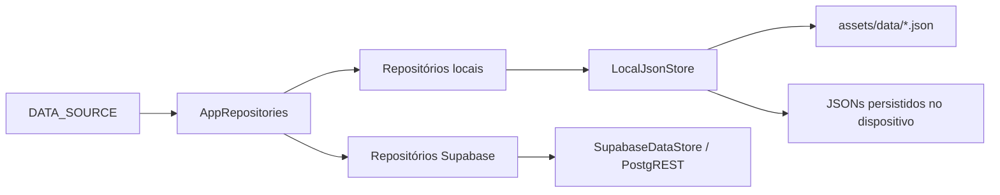

# Repositórios e provedores

`DATA_SOURCE=local` é o padrão. `DATA_SOURCE=supabase` ativa os repositórios diretos do Supabase; `api` preserva o backend antigo para compatibilidade e extrações. `DataSource.environment` lê o ambiente de compilação e `AppRepositories` monta as dependências.

```powershell
fvm flutter run -d windows --dart-define-from-file=.env
```

Copie `.env.example` para `.env`. O Flutter não carrega esse arquivo em tempo de execução: uma troca de ambiente exige reiniciar a execução ou recompilar.

Há somente um arquivo ativo de configuração do Flutter: `.env`. O arquivo `.env.example` é o modelo versionado; o `.env` da raiz do repositório pertence ao backend/site. Os antigos `config.*.json` foram removidos e seus valores públicos locais foram preservados no `.env`.

| Contrato | Local | Supabase |
| --- | --- | --- |
| `CourseRepository` | `LocalCourseRepository` | `SupabaseCourseRepository` |
| `CurriculumRepository` | `LocalCurriculumRepository` | `SupabaseCurriculumRepository` |
| `ContentsRepository` | `LocalContentsRepository` | `SupabaseContentsRepository` |
| `ScheduleRepository` | `LocalScheduleRepository` | `SupabaseScheduleRepository` |
| `FeedbackRepository` | `LocalFeedbackRepository` | `SupabaseFeedbackRepository` |
| `AuthRepository` | `LocalAuthRepository`, sem login | `SupabaseAuthRepository` |
| `AdminRepository` | `LocalAdminRepository` | `SupabaseAdminRepository` |
| `LocalStorageRepository` | `SharedPreferencesLocalStorageRepository` | Mesmo armazenamento para preferências e cache |

Os contratos estão em `lib/domain/repositories/`. As implementações ficam em `lib/data/repositories/local/` e `supabase/`. Regras de composição dos documentos são compartilhadas em `DocumentCourseRepository`, `document_repositories.dart` e `DocumentFeedbackRepository`; esses componentes dependem de `AcademicDataStore`, sem conhecer HTTP ou SharedPreferences.



## JSON local

`LocalJsonStore` lê o registro `assets/data/courses.json` e os arquivos de cada curso. Cada documento inicial contém currículo, ementas e horários por semestre. Os repositórios acessam cada tipo separadamente:

| Documento persistido | Conteúdo |
| --- | --- |
| `local_data_v1_courses` | Registro e metadados dos cursos |
| `local_data_v1_course_curricula` | Currículos, perfis e matriz |
| `local_data_v1_course_contents` | Ementas e conteúdos |
| `local_data_v1_course_schedules` | Ofertas por curso/semestre e metadados da extração |
| `local_data_v1_site_feedback` | Feedbacks registrados neste dispositivo |

São strings JSON no armazenamento da plataforma via SharedPreferences, tanto no Web quanto em aplicações nativas. Os assets embarcados são somente leitura; não são arquivos editáveis da pasta do projeto depois do build. A primeira consulta usa os assets; quando há uma edição, o JSON daquele tipo é persistido e passa a ter precedência. Um documento vazio persistido continua vazio, evitando restaurar registros excluídos. JSON persistido inválido gera erro e não é sobrescrito silenciosamente.

As operações de `LocalJsonStore` compartilham uma fila entre instâncias no mesmo
isolate. `AcademicDataStore.writeCourse` valida o lote completo antes de publicar
metadados e documentos. O journal `local_data_v1_pending_batch` armazena os valores
anteriores das chaves alteradas antes da primeira gravação. Remover esse journal,
com confirmação do armazenamento, é o ponto de commit.

Uma falha restaura o conjunto anterior. Se a restauração também falhar, o journal
permanece e leituras/escritas acadêmicas ficam bloqueadas até a recuperação. Uma
nova instância ou reinício recupera o lote antes de retornar dados. O adaptador de
SharedPreferences fornece leitura recarregada da plataforma para a recuperação,
evitando confundir o cache otimista do plugin com uma gravação confirmada. Os
formatos e as chaves dos documentos anteriores continuam válidos.

Leituras retornam cópias dos dados. Alterações não são enviadas ao Supabase e o modo local não cria clientes HTTP ou sessões remotas para carregar os documentos. Cache e preferências pessoais têm chaves separadas; o backup pessoal existente não inclui automaticamente a base acadêmica local nem o journal. Exporte os currículos e horários na administração para transferi-los.

`LocalCourseRepository` compõe currículo, ementas e horário resolvido. A seleção estrita de semestre retorna oferta ausente sem substituir por outro semestre. A seleção normal usa o semestre visível preferido ou o último disponível. Alias de cursos são preservados.

`LocalAdminRepository` habilita a administração do dispositivo sem login. Importação e exportação JSON funcionam; extrações por IA e migrações dos arquivos do servidor exigem o modo API e não são simuladas como operações offline.

## Supabase direto

`SupabaseDataStore` usa a Data API com chave publicável, valida que a chave não é secreta e transmite o JWT somente nos repositórios do escopo administrativo. As consultas públicas nunca recebem a sessão do administrador. A paginação lê todos os documentos sem descartar silenciosamente linhas acima do limite do PostgREST.

Gravações acadêmicas usam uma única chamada a `commit_academic_course`, inclusive
quando um repositório grava somente currículo, ementas ou horário. A função aplica
o lote em uma transação PostgreSQL, mantém RLS com `SECURITY INVOKER` e serializa
operações do mesmo curso pelo mesmo advisory lock usado nas importações. A exclusão
do curso usa as chaves estrangeiras com cascade na mesma transação. Os indicadores
`hasCurriculum` e `hasSchedule` são recalculados a partir dos documentos persistidos;
patches de metadados preservam campos e semestres de outras operações.

A migração `../../supabase/migrations/20261028042143_atomic_academic_course_writes.sql`
precisa ser aplicada no ambiente alvo antes de distribuir este cliente ou backend.
Não há fallback para gravações separadas se a função estiver indisponível.
Ela foi validada em PostgreSQL local por testes; não foi aplicada ao banco remoto.

As tabelas são as existentes: `courses`, `course_curricula`, `course_contents`, `course_schedules` e `site_feedback`. A migração `../../supabase/migrations/20261018162901_flutter_direct_repositories.sql` habilita leitura pública dos documentos acadêmicos que já eram públicos pela API Express, e mantém as gravações sob RLS. Ela **não foi aplicada automaticamente ao banco remoto**.

Para administrar diretamente, atribua `app_metadata.academic_admin=true` à conta por um canal administrativo confiável do Supabase e entre novamente para receber o JWT atualizado. O RPC `flutter_is_academic_admin` e as políticas leem somente esse atributo confiável. `user_metadata` não autoriza alterações. A lista `ADMIN_USER_IDS` do Express continua específica do modo API.

Feedback permanece privado: só administradores podem consultar e editar suas notas. As atualizações usam PATCH, sem conceder INSERT direto. O envio público passa pelo endpoint de `API_BASE_URL`, preservando idempotência e proteção contra spam. O RPC de envio e a tabela de limites continuam exclusivos do servidor.

Use apenas `SUPABASE_URL` e `SUPABASE_PUBLISHABLE_KEY` no ambiente Flutter. Nunca inclua chave `service_role`, chave secreta ou credencial de IA. Fontes de referência: [segurança da Data API](https://supabase.com/docs/guides/api/securing-your-api) e [sessões](https://supabase.com/docs/guides/auth/sessions).

## Injeção, cache e testes

`setupDependencies()` é a entrada de composição. Seu cache é separado por fonte para não misturar documentos locais e remotos; a preferência de servidor legada só se aplica ao modo API. Repositórios podem ser substituídos na composição; um `AcademicApi` injetado explicitamente preserva o modo API para testes e integrações existentes. Home, Matriz, Horários e Configurações recebem seus ViewModels, sem receber `AppState`.

```dart
final dependencies = setupDependencies(repositories: AppRepositories(
  source: DataSource.local,
  courses: meuCourseRepository,
  localStorage: meuLocalStorageRepository,
));
final state = dependencies.state;
final matrixViewModel = dependencies.get<MatrixViewModel>();
```

`createAdminScope()` cria uma sessão própria e os repositórios autorizados correspondentes ao provedor. Fechar o escopo descarta a sessão e o cliente Supabase desse escopo. A API legada continua com os contratos de extrações e migrações existentes.

Os testes Dart cobrem execução local sem rede, persistência e exclusão após reinício, edição dos documentos, oferta estrita por semestre, feedback local idempotente, gravações concorrentes, JSON corrompido, consultas REST, paginação e isolamento dos tokens. Os testes SQL em `../../supabase/tests/` verificam as políticas e a separação entre `app_metadata` e `user_metadata`; precisam de um banco de teste com as migrações aplicadas.

`test/academic_batch_test.dart` injeta falhas na preparação, publicação e commit do
lote, verifica recuperação após reinício, leitores concorrentes e exclusão de todos
os documentos. Os testes Node `../../tests/academicTransactions.test.ts` executam as
migrações em PostgreSQL com PGlite, incluindo triggers que interrompem gravações e
exclusões, além dos controles de acesso. Veja [transações acadêmicas](../../docs/transacoes-academicas.md).

```powershell
fvm flutter analyze
fvm flutter test
```


## Leitura tipada de detalhes

`CourseRepository.get()` retorna `AsyncResult<CourseDetails>`. API, Supabase e
armazenamento local usam `CourseDetailsReader` para converter exceções em `Failure`
com `AppException`, preservando `cause` e `stackTrace`. `getDocument()` é o acesso
explícito aos documentos originais para edição administrativa, exportação e cache;
a listagem e os comandos de edição mantêm os contratos legados nesta etapa.

`AcademicDataRepository.get()` entrega `AsyncResult<AcademicRead<CourseDetails>>`.
O parser resolve os formatos atuais e legados, perfis, semestre, catálogo oficial
e ementas antes de entregar o resultado ao contexto. `CourseDetails` expõe coleções
tipadas, perfil ativo e data de exportação; a apresentação não interpreta o JSON
do curso. As coleções do resultado são somente leitura; o contexto mantém cópias
para suas definições observáveis existentes.

O cache continua no formato JSON anterior. Apenas respostas interpretadas com
sucesso substituem uma cópia válida. Cache inválido permite tentar os assets;
se todas as fontes falharem, o retorno é `Failure`, sem representar erro como uma
coleção vazia válida. Um fallback aceito informa `offline` e conserva a falha
original em `AcademicRead.failure`, também disponível em `AcademicContext.loadFailure`.

`test/course_details_test.dart` cobre os formatos, composição de ementas, dados
vazios válidos, falhas com causa/stack e validação das alternativas do cache.


## Desempenho de leitura e edição

- `CompletionRepositoryImpl` reutiliza um conjunto somente leitura por curso e
  JSON de origem. Importações, migrações e substituições externas do valor
  invalidam o cache automaticamente.
- A listagem local usa `AcademicCourseMetadataStore`, sem abrir currículos,
  ementas ou ofertas dos demais cursos. A primeira listagem de uma base nova lê
  apenas `courses.json`; os assets individuais são resolvidos sob demanda e
  compartilhados pelas consultas do mesmo curso. O registro conserva semestres
  históricos; a resolução estrita consulta os documentos reais.
- `AcademicDataStore.select(columns: ...)` permite projeção. Consultas de semestres
  não transportam ofertas completas do Supabase. No modo local, a decodificação
  persistida é reutilizada enquanto a string da tabela não mudar; filtros e
  projeção precedem a cópia recursiva dos resultados.
- A fila, o journal, a releitura autoritativa e os formatos `local_data_v1_*`
  continuam ativos. Os caches são privados, resultados não compartilham objetos
  mutáveis e uma restauração do journal invalida o cache pelo valor armazenado.
  Escritas que materializam tabelas completas ainda carregam os seeds necessários
  para preservar os documentos dos outros cursos.
- O editor administrativo memoriza a serialização por domínio. Alterações só
  invalidam o domínio correspondente; desfazer uma edição continua retornando ao
  baseline original. Leituras de `isDirty` não serializam o currículo novamente.
- Comandos de status e optativas consolidam notificações e persistência da matriz.
  O armazenamento pessoal suprime apenas valores idênticos já confirmados; dados
  pendentes ou rejeitados continuam graváveis e aguardáveis. Uma importação sem
  mudanças pode terminar sem uma nova gravação, pois os dados já estão persistidos.
- A matriz indexa identidade, ID, nomes/códigos normalizados e ofertas selecionadas.
  Os índices são invalidados quando as listas mudam. O parser indexa ementas uma
  vez e preserva a precedência da primeira correspondência da fonte, inclusive
  equivalências, códigos com zeros e disciplinas com códigos repetidos.

`test/performance_regression_test.dart` verifica leituras de assets, isolamento de
cópias, recuperação de caches, projeções remotas, confirmação de escrita, uma
publicação/gravação lógica por comando e correspondência de ementas. Esses testes
medem operações e invariantes; não representam medições de FPS ou latência em um
dispositivo de produção.
