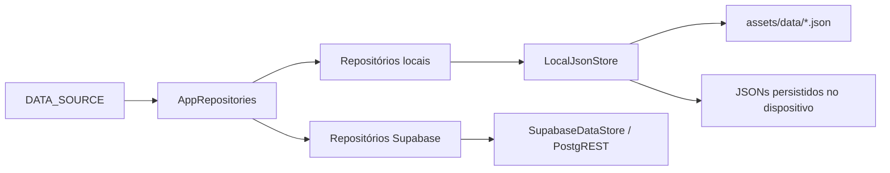

# Repositórios e provedores

`DATA_SOURCE=local` é o padrão. `DATA_SOURCE=supabase` ativa os repositórios diretos do Supabase; `api` preserva o backend antigo para compatibilidade e extrações. `DataSource.environment` lê o ambiente de compilação e `AppRepositories` monta as dependências.

```powershell
fvm flutter run -d windows --dart-define-from-file=.env
```

Copie `.env.example` para `.env`. O Flutter não carrega esse arquivo em tempo de execução: uma troca de ambiente exige reiniciar a execução ou recompilar.

Há somente um arquivo ativo de configuração do Flutter: `.env`. O arquivo `.env.example` é o modelo versionado; o `.env` da raiz do repositório pertence ao backend/site. Os antigos `config.*.json` foram removidos e seus valores públicos locais foram preservados no `.env`.

| Contrato | Local | Supabase |
| --- | --- | --- |
| `CourseRepository` | `LocalCourseRepository` | `SupabaseCourseRepository` |
| `CurriculumRepository` | `LocalCurriculumRepository` | `SupabaseCurriculumRepository` |
| `ContentsRepository` | `LocalContentsRepository` | `SupabaseContentsRepository` |
| `ScheduleRepository` | `LocalScheduleRepository` | `SupabaseScheduleRepository` |
| `FeedbackRepository` | `LocalFeedbackRepository` | `SupabaseFeedbackRepository` |
| `AuthRepository` | `LocalAuthRepository`, sem login | `SupabaseAuthRepository` |
| `AdminRepository` | `LocalAdminRepository` | `SupabaseAdminRepository` |
| `LocalStorageRepository` | `SharedPreferencesLocalStorageRepository` | Mesmo armazenamento para preferências e cache |

Os contratos estão em `lib/domain/repositories/`. As implementações ficam em `lib/data/repositories/local/` e `supabase/`. Regras de composição dos documentos são compartilhadas em `DocumentCourseRepository`, `document_repositories.dart` e `DocumentFeedbackRepository`; esses componentes dependem de `AcademicDataStore`, sem conhecer HTTP ou SharedPreferences.



## JSON local

`LocalJsonStore` lê o registro `assets/data/courses.json` e os arquivos de cada curso. Cada documento inicial contém currículo, ementas e horários por semestre. Os repositórios acessam cada tipo separadamente:

| Documento persistido | Conteúdo |
| --- | --- |
| `local_data_v1_courses` | Registro e metadados dos cursos |
| `local_data_v1_course_curricula` | Currículos, perfis e matriz |
| `local_data_v1_course_contents` | Ementas e conteúdos |
| `local_data_v1_course_schedules` | Ofertas por curso/semestre e metadados da extração |
| `local_data_v1_site_feedback` | Feedbacks registrados neste dispositivo |

São strings JSON no armazenamento da plataforma via SharedPreferences, tanto no Web quanto em aplicações nativas. Os assets embarcados são somente leitura; não são arquivos editáveis da pasta do projeto depois do build. A primeira consulta usa os assets; quando há uma edição, o JSON daquele tipo é persistido e passa a ter precedência. Um documento vazio persistido continua vazio, evitando restaurar registros excluídos. JSON persistido inválido gera erro e não é sobrescrito silenciosamente.

As gravações na mesma instância de `LocalJsonStore` são serializadas para preservar alterações concorrentes. Leituras retornam cópias dos dados. Alterações não são enviadas ao Supabase e o modo local não cria clientes HTTP ou sessões remotas para carregar os documentos. Cache e preferências pessoais têm chaves separadas; o backup pessoal existente não inclui automaticamente a base acadêmica local. Exporte os currículos e horários na administração para transferi-los.

`LocalCourseRepository` compõe currículo, ementas e horário resolvido. A seleção estrita de semestre retorna oferta ausente sem substituir por outro semestre. A seleção normal usa o semestre visível preferido ou o último disponível. Alias de cursos são preservados.

`LocalAdminRepository` habilita a administração do dispositivo sem login. Importação e exportação JSON funcionam; extrações por IA e migrações dos arquivos do servidor exigem o modo API e não são simuladas como operações offline.

## Supabase direto

`SupabaseDataStore` usa a Data API com chave publicável, valida que a chave não é secreta e transmite o JWT somente nos repositórios do escopo administrativo. As consultas públicas nunca recebem a sessão do administrador. A paginação lê todos os documentos sem descartar silenciosamente linhas acima do limite do PostgREST.

As tabelas são as existentes: `courses`, `course_curricula`, `course_contents`, `course_schedules` e `site_feedback`. A migração `../../supabase/migrations/20261018162901_flutter_direct_repositories.sql` habilita leitura pública dos documentos acadêmicos que já eram públicos pela API Express, e mantém as gravações sob RLS. Ela **não foi aplicada automaticamente ao banco remoto**.

Para administrar diretamente, atribua `app_metadata.academic_admin=true` à conta por um canal administrativo confiável do Supabase e entre novamente para receber o JWT atualizado. O RPC `flutter_is_academic_admin` e as políticas leem somente esse atributo confiável. `user_metadata` não autoriza alterações. A lista `ADMIN_USER_IDS` do Express continua específica do modo API.

Feedback permanece privado: só administradores podem consultar e editar suas notas. As atualizações usam PATCH, sem conceder INSERT direto. O envio público passa pelo endpoint de `API_BASE_URL`, preservando idempotência e proteção contra spam. O RPC de envio e a tabela de limites continuam exclusivos do servidor.

Use apenas `SUPABASE_URL` e `SUPABASE_PUBLISHABLE_KEY` no ambiente Flutter. Nunca inclua chave `service_role`, chave secreta ou credencial de IA. Fontes de referência: [segurança da Data API](https://supabase.com/docs/guides/api/securing-your-api) e [sessões](https://supabase.com/docs/guides/auth/sessions).

## Injeção, cache e testes

`AppState` recebe a composição. Seu cache é separado por fonte para não misturar documentos locais e remotos; a preferência de servidor legada só se aplica ao modo API. Repositórios podem ser substituídos no construtor; um `AcademicApi` injetado explicitamente preserva o modo API para testes e integrações existentes.

```dart
final state = AppState(repositories: AppRepositories(
  source: DataSource.local,
  courses: meuCourseRepository,
  localStorage: meuLocalStorageRepository,
));
```

`createAdminScope()` cria uma sessão própria e os repositórios autorizados correspondentes ao provedor. Fechar o escopo descarta a sessão e o cliente Supabase desse escopo. A API legada continua com os contratos de extrações e migrações existentes.

Os testes Dart cobrem execução local sem rede, persistência e exclusão após reinício, edição dos documentos, oferta estrita por semestre, feedback local idempotente, gravações concorrentes, JSON corrompido, consultas REST, paginação e isolamento dos tokens. Os testes SQL em `../../supabase/tests/` verificam as políticas e a separação entre `app_metadata` e `user_metadata`; precisam de um banco de teste com as migrações aplicadas.

```powershell
fvm flutter analyze
fvm flutter test
```
