# Validação da reconstrução

Verificação realizada em 18/10/2026, horário de São Paulo, com Flutter 3.47.5 e Dart 3.13.4 pelo FVM.

## Configuração única do Flutter

Os arquivos `config.*.json` foram removidos. Os valores públicos existentes de `config.local.json` foram migrados para `.env` sem sobrescrever valores já preenchidos; `DATA_SOURCE=local` foi preservado. `.env.example` permanece como modelo versionado e `.env` é ignorado pelo Git. O gerador foi renomeado para `tool/prepare_env.cjs` e passou a escrever somente o `.env` do Flutter. O ambiente da raiz continua pertencendo ao backend/site.

## Provedor local padrão e Supabase configurável

`DATA_SOURCE` seleciona os provedores em `AppRepositories`, com `local` como padrão mesmo sem arquivo de ambiente. Foram adicionados contratos e implementações específicos para currículos, ementas e horários; cursos e feedback também têm implementações locais e Supabase. Os JSONs iniciais incluem nove cursos e sete ofertas semestrais, atualizados por consultas públicas de leitura, incluindo BCC 2026.2 com 47 ofertas e nove optativas. Nenhum dado foi publicado ou alterado no servidor durante a sincronização.

O modo local não exige API ou login. A administração salva documentos JSON por tipo no armazenamento do dispositivo via SharedPreferences, com precedência sobre os assets; exclusões não restauram registros do seed. Gravações concorrentes são serializadas. A importação/exportação JSON permanece disponível. As opções de IA e migração de arquivos do servidor ficam no modo API. A seleção do semestre também foi corrigida no fallback de assets quando o registro anuncia um semestre sem um horário correspondente.

O modo Supabase usa a Data API para os documentos acadêmicos. A migração `supabase/migrations/20261018162901_flutter_direct_repositories.sql`, na raiz do projeto, prepara os grants, RLS e a verificação de `app_metadata.academic_admin`. A migração foi gerada pelo CLI 2.121.0 e **não foi aplicada ao banco remoto**. Os testes SQL de segurança foram atualizados e receberam casos de leitura pública, bloqueio de escrita por contas comuns, feedback privado e rejeição de autorização via `user_metadata`; não foram executados nesta etapa, e nenhum banco de teste foi iniciado.

A suíte Flutter completa passou com **103 testes** e a análise estática terminou com **No issues found**. Os sete novos cenários cobrem execução local sem clientes HTTP, persistência após reinício, edição e exclusão, filtros de semestre, feedback idempotente, JSON corrompido, concorrência, REST Supabase paginado, isolamento de tokens e edição local pela interface sem login. As consultas Supabase foram verificadas com HTTP controlado, sem autenticar contas ou modificar o banco remoto. O build Web usa `--dart-define-from-file=.env`, com `DATA_SOURCE=local`; Windows e Android não foram recompilados.

Configuração e detalhes: [repositorios.md](repositorios.md).

## Acesso às optativas nos horários

A consulta da prévia confirmou 47 ofertas do BCC em 2026.2, incluindo nove optativas. O botão Optativas permanece depois do último período, conforme solicitado. A faixa recebeu barra de rolagem visível e setas para navegar até o final. Com texto ampliado, cada botão respeita a largura visível e pode quebrar o rótulo em linhas.

Os três novos testes verificam a posição das optativas após o último período, barra visível, navegação pelas setas até o filtro, nove resultados e inclusão de uma optativa na grade, em desktop, celular e texto 3×. A suíte completa passou com **96 testes**, e a análise estática terminou com **No issues found**. As cinco capturas de horários foram atualizadas. O build Web desta etapa inclui também a organização dos repositórios; Windows e Android não foram recompilados.

## Repositórios e interfaces

Foram criados sete contratos em `domain/repositories/` e implementações agrupadas em `data/repositories/api/`, `supabase/` e `local/`. `AppRepositories` concentra a composição e a troca de servidor. Estado, preferências, feedback e administração passaram a usar os contratos; as telas não montam endpoints HTTP. A implementação de autenticação Supabase foi retirada da pasta de telas e cada escopo administrativo mantém sua própria sessão em memória. As operações acadêmicas continuam usando a API existente.

A suíte completa passou com **93 testes** e `flutter analyze` terminou com **No issues found**. Os quatro novos cenários verificam injeção das interfaces com armazenamento em memória, cache offline, isolamento dos tokens entre escopos administrativos e consultas públicas, logout, troca de servidor e codificação de identificadores. Os testes de renovação concorrente e rejeição de chaves privilegiadas foram preservados em `supabase_auth_repository_test.dart`. As chamadas de autenticação usam HTTP simulado, sem modificar contas ou banco remoto.

O mapa dos contratos e os exemplos de injeção estão em [repositorios.md](repositorios.md). Esta etapa não gerou builds; os artefatos existentes correspondem à correção anterior dos nomes cortados na exportação.

## Imagem da grade e sábado condicional

O botão Salvar imagem agora gera uma composição própria, baseada em `ScheduleExportCard.tsx` e na referência enviada: logotipo, título, curso/semestre, quantidade de matérias, grade sem controles, rodapé e data. O documento é claro e tem 1150 px lógicos, exportados em PNG com largura de 2300 px. Inclui todos os turnos selecionados, independentemente do filtro visual, tamanho da tela, tema e posição de rolagem. As disciplinas sem um horário utilizável ficam em uma seção própria.

A coluna de sábado aparece somente quando uma disciplina selecionada tem uma sessão válida nesse dia, tanto na grade interativa quanto no documento. Ofertas de sábado que não foram adicionadas à grade não criam a coluna.

A altura das linhas exportadas acompanha o conteúdo real dos cartões. Os nomes completos das disciplinas e dos professores podem quebrar em mais linhas, sem comprimir ou cortar as letras. A medição considera a largura menor quando o sábado está presente, preservando a posição dos encontros que ocupam vários intervalos.

A suíte completa passou com **89 testes** e a análise estática terminou com **No issues found**. Os testes verificam inclusão/remoção do sábado, horários inválidos, disciplinas sem horário, nomes longos sem truncamento ou corte vertical, resolução do PNG, ausência de botões no documento e igualdade do PNG entre desktop claro e celular escuro com texto ampliado. A captura usa a mesma função de renderização acionada pelo botão, com cinco ofertas reais do BCC e data fixa para comparação.

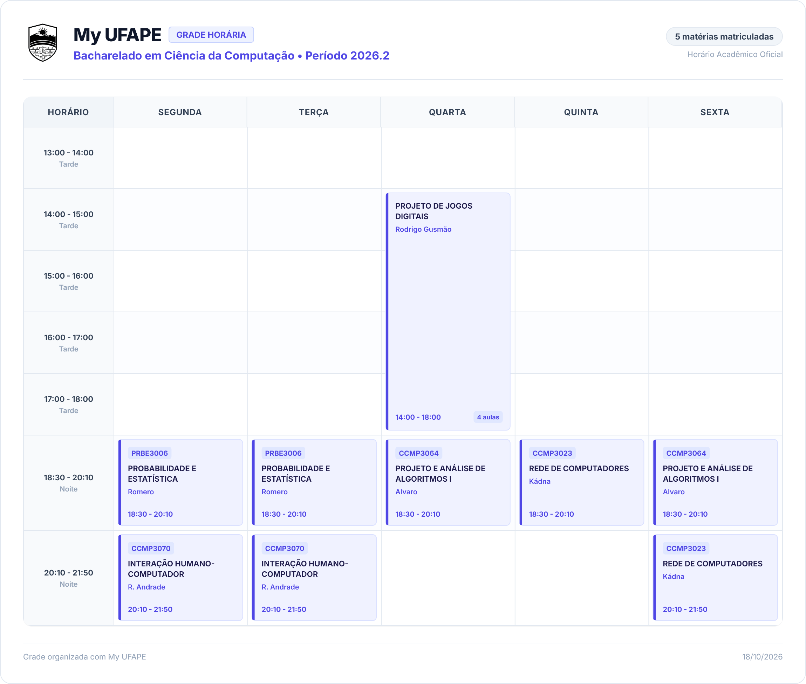

Para repetir: `fvm flutter test test/schedule_export_test.dart --dart-define=SCHEDULE_EXPORT_SCREENSHOT=true`.

O build Web foi atualizado e a prévia na porta 8787 foi conferida por HTTP e SHA-256. Os pacotes Windows e Android continuam correspondendo à etapa anterior de builds.

## Builds atualizados após a refatoração

Foram gerados os builds release Web, Windows x64 e APK Android com as alterações de catálogo, matriz, horários, animações e organização dos componentes. A configuração pública existente foi reutilizada; Windows e Android usam a API publicada configurada no README. Os 84 testes e a análise estática haviam passado na validação da refatoração.

O servidor local foi reaberto em `http://127.0.0.1:8787`, com a API publicada como destino do proxy. A verificação HTTP retornou 200, confirmou que o JavaScript servido tem o mesmo SHA-256 do novo build e consultou nove cursos. O ZIP Windows contém os 77 arquivos do diretório release, incluindo executável, engine, bibliotecas e dados. O APK passou em `apksigner verify` com assinatura v2 e o certificado de teste Android já configurado no projeto.

Artefatos atualizados: `build/web/`, `build/windows/x64/runner/Release/`, `build/releases/My-UFAPE-windows-x64.zip` e `build/app/outputs/flutter-apk/app-release.apk`. Os checksums atualizados estão em `build/releases/SHA256SUMS.txt`.

## Organização dos componentes Flutter

Tema, navegação e cabeçalho foram separados da inicialização. Matriz, horários e catálogo passaram a usar componentes de apresentação com dados e callbacks explícitos. O resumo, editor de optativas e painter da matriz ficam em módulos próprios; nos horários, cálculo dos intervalos, grade semanal, cartões de oferta/aula e animação de sessões foram separados. A paleta acadêmica e a política de movimento reduzido são compartilhadas. O mapa está em [estrutura-codigo.md](estrutura-codigo.md).

A suíte completa passou com **84 testes** e a análise estática terminou com **No issues found**. Foram registradas capturas imediatamente antes da refatoração e repetidos os mesmos 17 cenários de matriz, horários e catálogo depois dela. Todos os 17 PNGs mantiveram o mesmo SHA-256, incluindo desktop, celular, paisagem, tema escuro e texto ampliado. Os testes de interações, zoom, movimento reduzido, exportação PNG, persistência e navegação administrativa também passaram. Nenhum build foi gerado.

## Animações da matriz curricular

Os cartões da matriz animam as cores e bordas ao trocar status; os ícones, totais dos períodos e indicadores do resumo têm transições de 160–200 ms. A barra de progresso interpola a partir do valor atual em 320 ms, inclusive quando outra alteração interrompe a animação. Ao passar o mouse, cartões sem relação perdem opacidade gradualmente e os vínculos de pré-requisitos aparecem com desenho progressivo em 220 ms. A animação das linhas repinta sua própria camada e preserva os widgets dos cartões.

Pesquisa, filtros, troca de perfil e alternância entre matriz/lista usam transições curtas, com ajuste de altura. Os resultados em saída ficam sem ponteiro, foco e semântica. A pesquisa preserva a instância da visualização interativa e sua transformação; o zoom segue imediato. Movimento reduzido e navegação acessível desativam as transições personalizadas. Campos de horas continuam atualizando o estado imediatamente.

A suíte completa passou com **84 testes**, e a análise estática terminou com **No issues found**. Os sete novos cenários verificam interpolação de cores, cliques rápidos, progresso interrompido, hover sem recriar cartões, preservação de zoom/foco nos filtros, alternância no celular e as duas preferências de acessibilidade. Comando específico: `fvm flutter test test/matrix_motion_test.dart`. Nenhum build foi gerado nesta etapa.

## Animações da página de horários

A grade ganhou entrada com fade e escala discreta em 240 ms, saída em até 160 ms e reposicionamento suave dos blocos e linhas quando os turnos mudam. Os cartões da lista animam cores, bordas e altura; os ícones de seleção/conclusão e o contador têm transições curtas. Pesquisa e filtros trocam os resultados com fade e pequeno deslocamento, sem animar a tabela inteira a cada seleção. As abas do celular usam uma transição de 280 ms.

Os controles que estão saindo deixam imediatamente de receber ponteiro, foco e leitura por acessibilidade. Uma nova seleção durante a saída reverte a animação existente. A preferência de movimento reduzido e a navegação acessível desativam as transições personalizadas. A exportação PNG aplica a posição e a opacidade finais antes da captura.

A suíte completa passou com **77 testes**; a análise estática terminou com **No issues found**. Os oito testes de animação verificam estados intermediários, inclusão/remoção rápida, conclusão, descarte da tela durante uma saída, mudança de turno, resultados antigos desativados, duas preferências de acessibilidade, abas no celular e exportação PNG durante uma entrada. Comando específico: `fvm flutter test test/schedule_motion_test.dart`. Não foram gerados builds nesta etapa.

## Refinamento visual da matriz e navegação pelo topo

A navegação lateral global foi removida de todas as telas internas. O menu ⋮ no cabeçalho reúne os destinos do aplicativo e o feedback; a marca e o conteúdo do cabeçalho ficam centralizados em até 1280 px. A fonte Inter e o índigo do site são usados na interface.

A matriz foi compactada para acompanhar a imagem de referência: cartões regulares de 108 px, optativas com alturas próprias, indicadores no canto, filtros em uma única faixa no desktop e resumo em três cartões abaixo. Toque alterna o status; detalhes e nota continuam acessíveis no canto, por clique direito ou toque prolongado. As horas respondem à digitação e ao controle deslizante. Requisitos ausentes continuam distintos de uma exigência explícita de zero horas.

A suíte integrada passou com **63 testes** e a análise estática terminou sem problemas. Os testes verificam a navegação pelo menu superior sem Drawer/NavigationRail, a troca de status, as horas editáveis, o zoom, importação/exportação, celular, paisagem, tema escuro e fonte 3× com optativa de nome longo. A captura de referência abaixo usa o perfil BCC02 e progresso de exemplo criado exclusivamente nos testes, sem modificar os dados pessoais do usuário.

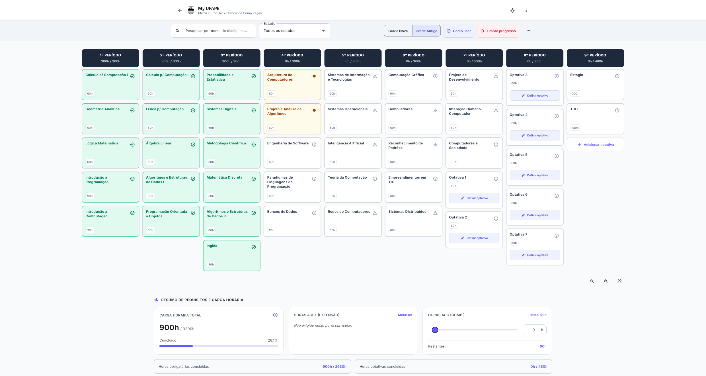

Nesta etapa foram executados testes e análise estática, **sem gerar builds Web, Windows ou Android**, conforme solicitado. Os artefatos compilados de etapas anteriores não foram atualizados.

## Evidência de execução

- API pública e backend local retornaram nove cursos cadastrados, três visíveis na página inicial.
- A prévia Flutter consultou a API por `/api/courses` e pelos detalhes de BCC 2026.2, sem modificar dados acadêmicos publicados.
- Uma turma adicionada apareceu nos encontros corretos da grade. A inclusão de outra turma sobreposta foi bloqueada com mensagem de conflito.
- A matriz mostrou a disciplina agendada como cursando, perfis BCC02/BCC03 e as respectivas relações e metas.
- Link direto da matriz com curso, semestre e perfil foi mantido depois de recarregar a página em uma aba de verificação separada.
- Catálogo retornou 99 disciplinas; a busca por `geometria` encontrou MATM3021. O detalhe exibiu carga horária, ementa, conteúdo programático e equivalências.
- Calendário abriu a página 9/16 correspondente a outubro de 2026; navegação para a página 10 e zoom de 125% funcionaram.
- Administração apresentou o formulário de login, sem expor o painel nem realizar gravações remotas.

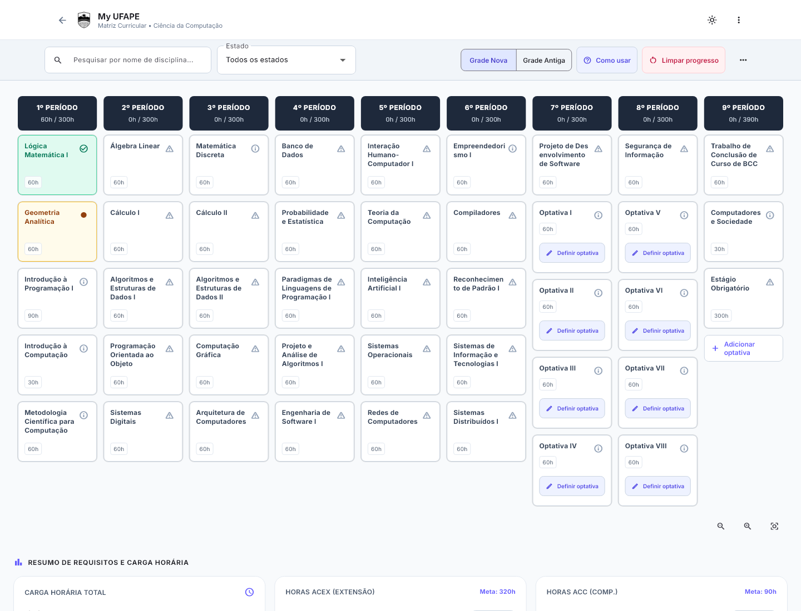

## Matriz alinhada à versão React

A tela foi reorganizada a partir de `src/components/MatrizView.tsx`: matriz em largura total, filtros e perfis no topo, cabeçalhos de período em slate, cartões pendentes neutros, cursando em âmbar e concluídos em verde. O resumo de carga horária, ACEX e ACC aparece abaixo da grade. As relações de pré-requisitos e dependentes usam rosa e verde-água e aparecem ao destacar uma disciplina. No celular, a visualização inicial é uma lista por período.

A suíte passou com **55 testes**, e a análise estática terminou sem problemas. Os cinco cenários novos usam os dados reais embarcados de BCC: desktop 1440 × 1100, celular 375 × 844, paisagem 844 × 390, tablet escuro 834 × 1194 e celular com texto ampliado em 3× e animações desativadas. As capturas abaixo são renderizações desses testes de widget. Também foi inspecionada a prévia Web local no navegador.

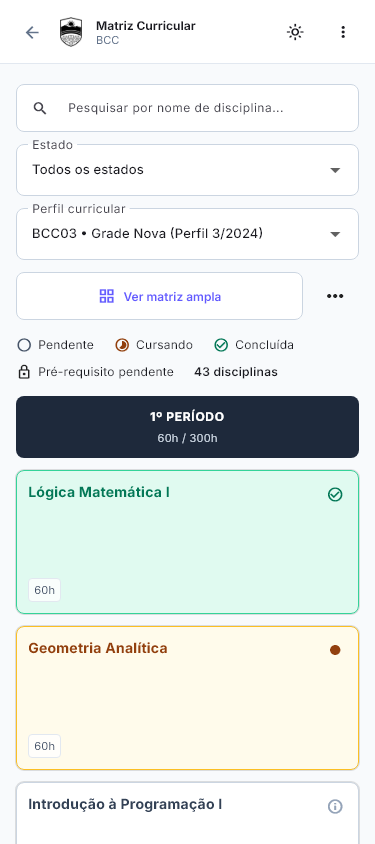

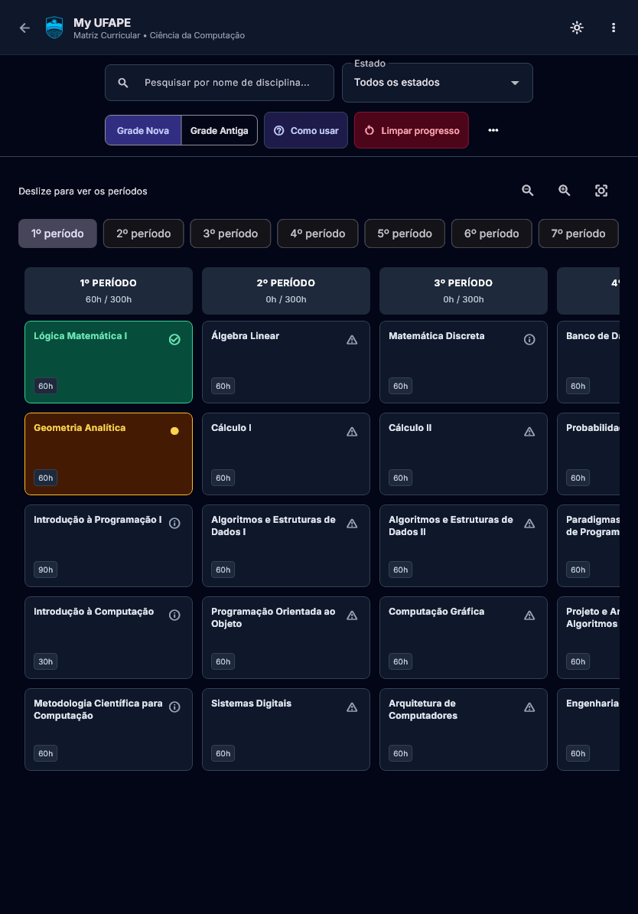

Os builds Web e Windows foram atualizados com esta matriz, assim como o ZIP Windows e os checksums. O APK existente corresponde à etapa anterior.

Para repetir as capturas: `fvm flutter test test/matrix_design_test.dart --dart-define=MATRIX_SCREENSHOTS=true`.

## Horários com a composição do site

A página de horários foi reconstruída a partir da imagem enviada, da observação do site publicado e dos componentes React. A análise está em [engenharia-reversa-horarios.md](engenharia-reversa-horarios.md). A grade usa cartões índigo uniformes, blocos contínuos para aulas longas, cabeçalho com semestre e filtros de turno em botões. A lista lateral usa os estados de seleção, conclusão e conflito da referência.

A suíte integrada passou com **60 testes**, e `flutter analyze` terminou sem problemas. Cinco testes novos exercitam BCC 2026.2 com os horários públicos capturados como fixture local: desktop, celular de 375 px, paisagem, tema escuro e texto 3× com animações desativadas. A seleção de cinco disciplinas reproduz a imagem: Jogos Digitais, Probabilidade e Estatística, Projeto e Análise de Algoritmos I, Rede de Computadores e Interação Humano-Computador. O filtro Noite remove o bloco da tarde; Automático o restaura. Os testes anteriores de conflitos e conclusões continuam passando.

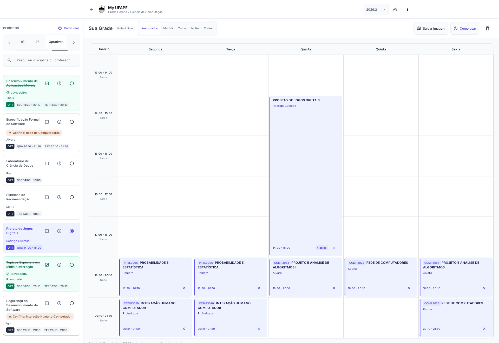

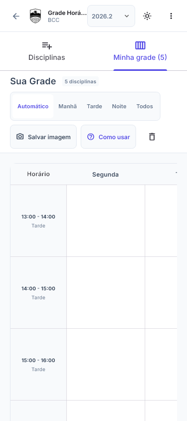

As capturas acima são renderizações de testes de widgets. Os builds Web e Windows foram atualizados nesta etapa. O APK existente continua correspondendo à entrega anterior.

## Testes e builds

### Home com o design do site

A home foi reconstruída com base em `src/components/HomeView.tsx`, `src/components/ProjectFooter.tsx`, `src/index.css` e na imagem fornecida pelo usuário. A fonte Inter e a licença foram obtidas do repositório oficial Google Fonts e incluídas no aplicativo. O fundo é desenhado em Dart: cores `#f8fafc`/`#020617`, pontos de raio 1 px e espaçamento de 16 px.

Conferência visual no navegador em 1116 × 1189 e 390 × 844: três cartões lado a lado no desktop, uma coluna no celular, calendário e rodapé sem corte horizontal e tema escuro com o logotipo azul. O botão de feedback abriu o formulário e foi cancelado; o cartão Horário Letivo abriu `/schedule` preservando curso, semestre e perfil. Nenhum feedback foi enviado. Os controles de preferências, tema e administração continuam acessíveis no canto superior da home. A área segura do sistema é respeitada em dispositivos móveis.

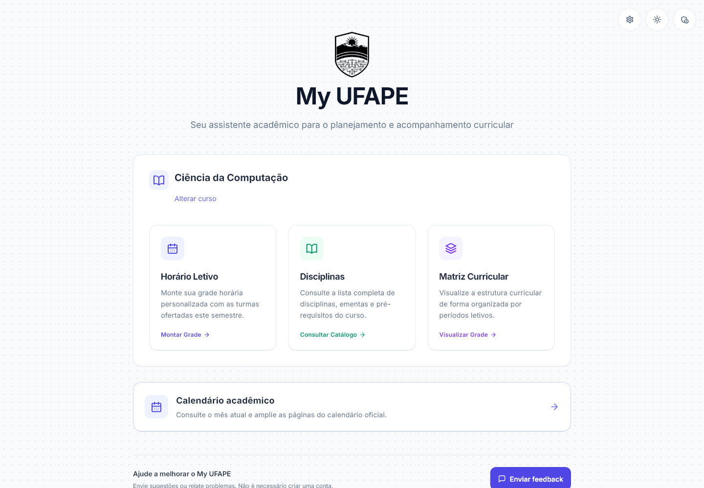

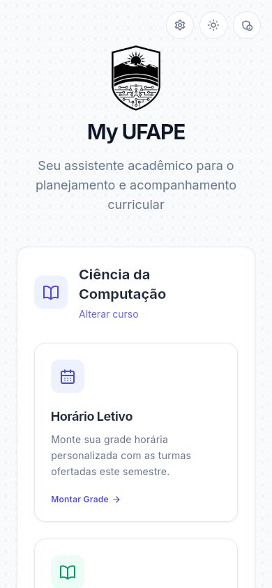

A suíte integrada final passou com **50 testes**, incluindo exportação/importação e limpeza por perfil, backup de instalação nova, nomes de arquivos para perfis como `Perfil 4/2024`, validação de notas e saída da tela de login sem falso aviso de alterações. A análise estática pelo FVM terminou com **No issues found**.

O zoom da matriz tem testes de regressão com eventos de mouse e trackpad, Ctrl esquerdo/direito, limites de 35% a 160%, preservação do ponto sob o cursor e retorno à rolagem normal ao soltar Ctrl. Durante Ctrl + roda, a posição de rolagem da página permanece fixa, inclusive no limite do zoom. Eventos de escala do navegador, pinça por toque e botões de zoom também foram verificados. A roda sem Ctrl preserva toda a transformação da matriz e rola somente a página.

Na prévia Web, um evento de roda sem Ctrl deslocou o conteúdo da página em 120 px, mantendo o tamanho do controle de status da disciplina em 167 × 35 px. Web e Windows foram recompilados pelo FVM com essa correção; o ZIP Windows e os checksums foram atualizados.

Os testes cobrem conflitos e horários adjacentes, isolamento de curso/semestre/perfil, conclusões compartilhadas por código, dados offline, cinco snapshots reais, migração de backups, optativas, JSON administrativo, autenticação simulada, detalhes e layouts de 390 e 1440 pixels.

Builds Web, Windows x64 e APK Android foram gerados pelo FVM. O APK otimizado e o modo debug usam assinatura de teste para avaliação. O Windows deve ser distribuído com suas DLLs e pasta `data/`; o ZIP inclui o diretório completo. Os comandos reproduzíveis estão no README.

Artefatos finais: `build/web/`, `build/windows/x64/runner/Release/`, `build/releases/My-UFAPE-windows-x64.zip` e `build/app/outputs/flutter-apk/app-release.apk`. O APK foi verificado com `apksigner`; os checksums SHA-256 estão em `build/releases/SHA256SUMS.txt`. O APK debug intermediário foi removido para evitar confusão com a entrega final.

## Catálogo com a composição do site

O catálogo foi ajustado a partir da imagem enviada e de `src/components/DisciplinesView.tsx`: conteúdo de 896 px, filtros compactos e cartões de 186 px em duas colunas no desktop. Código e período ficam no topo; horas, créditos publicados e acesso à ementa ficam no rodapé. O cabeçalho identifica o catálogo e apresenta `curriculum.export_date` no horário local, quando disponível.

A suíte completa passou com **69 testes** e a análise estática terminou com **No issues found**. Os seis cenários do catálogo incluem desktop, tela ampla, celular, paisagem, tema escuro e texto em 300%. Foram verificados os filtros de período/tipo combinados, a ausência de resultados, a busca por código e a abertura de ementas. As capturas abaixo são renderizações dos widgets com dados locais reais do BCC; não são capturas do build Web servido na porta 8787.

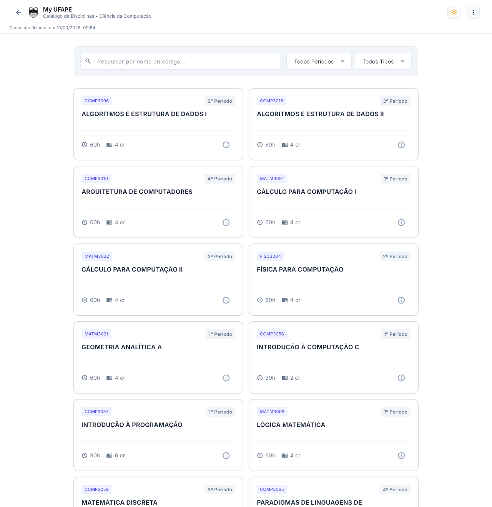

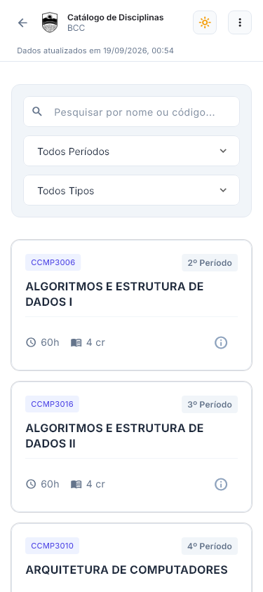

Nenhum build foi gerado nesta etapa. Para repetir as capturas: `fvm flutter test test/catalog_design_test.dart --dart-define=CATALOG_SCREENSHOTS=true`.

## Ambiente Android

O gerenciador Android instalado não encontrou o NDK 28.2.13676358 exigido pelo SDK Flutter. O pacote r28c foi obtido do download oficial, teve o SHA1 conferido contra a [publicação do Android NDK](https://github.com/android/ndk/wiki/unsupported-downloads) e foi instalado no SDK local.

A compilação Kotlin dos plugins falhou ao relacionar o cache Pub no disco C: com o projeto no disco G:. O projeto desativa o cache incremental Kotlin e usa execução dentro do processo Gradle, opções descritas na [documentação do Kotlin](https://kotlinlang.org/docs/gradle-compilation-and-caches.html). O APK compilou após o ajuste.

## Limites

Autenticação e ações administrativas são verificadas com respostas simuladas; não foram usadas credenciais pessoais nem executadas publicações, migrações ou extrações pagas em produção. Não houve teste em aparelho Android físico. O Windows foi compilado, sem validação visual automatizada do aplicativo nativo. iOS requer macOS/Xcode e não foi compilado neste Windows.

Os testes de interface para celular usam viewport de 390 pixels. A cópia offline distribuída vem do diretório legado `.backup/src/data`; a API continua sendo a fonte dos dados publicados.

## Animações da matriz — 18/10/2026

A matriz mantém os cartões presentes nos resultados enquanto anima entrada, saída e reposicionamento. Cartões em saída deixam de receber cliques, foco e leitura por acessibilidade. A entrada gradual tem um atraso máximo de 96 ms; hover, foco e pressão usam transformações pequenas, sem alterar a área reservada no layout.

Zoom e restauração pelos botões interpolam a transformação atual. Comandos rápidos acumulam o destino; Ctrl + roda, arraste e pinça interrompem a animação e assumem o controle imediatamente. A busca preserva o zoom e a identidade dos cartões mantidos. A edição de optativas anima a altura dos cartões, os modos Catálogo/Manual e mensagens de validação; os detalhes animam a apresentação do campo de nota. Pesquisa e valores digitados são preservados na troca de modo.

O movimento reduzido e a navegação acessível aplicam os valores finais imediatamente. Os campos continuam atualizando o estado enquanto as transições acontecem. Os controllers de entrada/saída e zoom são descartados ao sair da tela.

Validação: **109 testes aprovados** na suíte completa; `flutter analyze` sem problemas. Os testes incluem filtros rápidos revertidos durante a saída, cancelamento de pressão, crescimento e redução de optativas, interrupção do zoom pela roda, descarte durante animação, retirada de foco de notas e manutenção dos campos das optativas. As seis capturas da matriz foram atualizadas: desktop, referência ampla, celular, paisagem, tablet escuro e texto em 300%. São capturas de widgets; o comportamento temporal foi verificado com avanços parciais dos frames nos testes.

O build Web release foi atualizado usando `.env`. A prévia em `http://127.0.0.1:8787/` retornou HTTP 200 para `main.dart.js`, com SHA-256 idêntico ao arquivo compilado. Os checksums foram atualizados; APK e Windows permanecem nos builds anteriores a esta alteração de animações.

## Responsividade da matriz no celular — 18/10/2026

A matriz ampla usa colunas de pelo menos 220 px em telas estreitas, com navegação horizontal. No celular, os cartões têm texto de 14 px, até quatro linhas no título e altura maior. Atalhos de período e controles de zoom ficam acima do grafo; o menu de ações reúne ajuda, importação/exportação e limpeza com confirmação. Em larguras a partir de 480 px, estado e perfil dividem a mesma linha quando o tamanho de texto permite.

A posição é ajustada quando filtros ou mudanças de tamanho deixariam os resultados fora da área visível, preservando a escala. Se o filtro deixa apenas um período, o início do cartão fica visível mesmo quando o zoom faz sua largura ultrapassar a tela.

Validação: **114 testes aprovados** na suíte completa e `flutter analyze` sem problemas. Os dez cenários de layout da matriz incluem lista e matriz ampla, telas de 320, 390 e 600 px, paisagem, tablet, temas claro/escuro e texto ampliado. Os testes verificam largura e altura dos cartões, salto até o último período, zoom seguido de pesquisa, retorno à lista, arraste horizontal e rolagem vertical iniciados dentro da matriz. O menu mobile foi verificado com abertura da ajuda e confirmação/cancelamento da limpeza.

Capturas de widgets atualizadas: `matriz-phone-wide-small.png`, `matriz-phone-wide-dark.png`, `matriz-phone-wide-600.png` e `matriz-phone-wide-text.png`, além dos seis cenários anteriores. As capturas da matriz ampla mostram a página após rolar até o botão de visualização; não são capturas de navegador ou aparelho físico.

Build Web release atualizado com `.env`; a prévia local retornou HTTP 200 e o SHA-256 de `main.dart.js` correspondeu ao arquivo compilado. APK e Windows não foram recompilados nesta etapa.

## Página inicial em telas pequenas — 18/10/2026

O cabeçalho reduz logotipo, tipografia e espaçamentos em telas estreitas ou com menos de 500 px de altura. Os cartões de acesso passam para uma composição compacta com ícone lateral, descrição e ação. Com texto ampliado, ícone e conteúdo se empilham para preservar a largura útil. A quantidade de colunas considera a largura disponível dentro do painel, evitando três cartões apertados em tablets e paisagem.

A seleção de curso limita a largura das siglas, permite que os nomes quebrem linha e usa uma composição vertical com fontes grandes. Calendário e rodapé seguem o mesmo comportamento responsivo. Controles superiores e links têm áreas de toque de pelo menos 48 px; o botão de feedback ocupa a largura disponível no celular. O movimento reduzido também é respeitado no deslocamento de hover dos cartões.

Validação: suíte completa com **123 testes aprovados**, análise estática sem problemas e nova execução dos **15 testes** da home/navegação após o ajuste final do cabeçalho em paisagem. Os oito cenários visuais incluem 320, 390, 600, 844 e 1440 px, temas claro/escuro, seleção inicial, curso escolhido e fonte em 300%. Cada cenário verifica também o rodapé. Os acessos aos três módulos acadêmicos, calendário, preferências e administração foram testados em uma tela de 320 px, com manutenção do curso escolhido.

As capturas `home-small-choices.png`, `home-small-selected.png`, `home-phone-dark.png`, `home-tablet.png`, `home-landscape.png`, `home-large-choices.png`, `home-large-selected.png` e `home-desktop.png`, com suas versões `-footer`, são renderizações de widgets, sem teste em aparelho físico.

O build Web release foi atualizado com `.env`. A prévia local retornou HTTP 200 e o SHA-256 de `main.dart.js` correspondeu ao arquivo compilado. APK e Windows não foram recompilados nesta etapa.

## Foco e menus de contexto — 18/10/2026

A pesquisa recebe foco ao abrir a definição de optativa; no modo manual, o nome recebe foco. Os cartões da matriz têm menu de botão direito para detalhes/notas, escolha explícita de status e edição de optativas. Ofertas da lista e blocos da grade semanal oferecem detalhes, adição/remoção e conclusão conforme suas ações disponíveis. As regras existentes de conflito e conclusão continuam sendo aplicadas pelo estado.

`AcademicContextMenu` compartilha o comportamento de mouse e teclado (`Shift + F10`, tecla de menu e `Esc`). O menu nativo do navegador é suspenso enquanto existem cartões acadêmicos montados, preservando sua configuração anterior para restaurá-la ao sair. Os cliques normais e o toque prolongado da matriz mantêm suas ações.

Validação: **130 testes aprovados** na suíte completa e análise estática sem problemas. Os sete novos cenários verificam foco sem clicar no campo, status explícito sem ativar o clique normal, definição de optativa pelo menu, conflitos, conclusão, remoção, menu junto à borda e fechamento por teclado com restauração do foco.

O runner automatizado em Chrome não concluiu o carregamento e foi encerrado; seus casos Web não foram considerados aprovados. A prévia Web compilada foi verificada no navegador do app: o botão direito exibiu as ações da matriz sem o menu nativo, e `Esc` fechou sem modificar o progresso. Registro visual: `docs/screenshots/matriz-menu-contexto.png`.

## Proporção dos ícones — 18/10/2026

O gerador recebia diretamente o brasão de 440 × 596 px e o esticava para um quadrado. `tool/generate_icons.dart` prepara telas quadradas com o brasão centralizado, preservando sua proporção. Os ícones de Windows e navegador usam transparência; Android/iOS usam as margens e fundos apropriados; os ícones maskable da PWA têm uma área segura própria.

O ICO contém versões nativas de 16, 24, 32, 48, 64, 128 e 256 px. O favicon usa uma revisão de URL para atualizar o cache. Os arquivos originais usados dentro das telas não foram alterados. O processo de geração está em [icones.md](icones.md).

Recursos de Windows, Android, Web e iOS regenerados e inspecionados visualmente. A análise estática passou sem problemas. Builds release Web, APK e Windows concluídos. O primeiro build Windows encontrou o executável original aberto (`LNK1104`); a compilação final foi realizada com uma cópia isolada dos fontes em `build/windows-icon-release-source/`, preservando o aplicativo em execução. Seu executável final fica em `build/windows-icon-release-source/build/windows/x64/runner/Release/my_ufape.exe`; o ZIP de distribuição é `build/releases/My-UFAPE-windows-x64.zip`.

O novo favicon foi servido pela prévia local com HTTP 200 e hash idêntico ao arquivo gerado. Os ícones iOS foram gerados, sem compilação iOS neste Windows. Instalação em Android físico e atualização do cache de atalhos nativos não foram automatizadas.

## Leitura direta Supabase — 18/10/2026

As quatro tabelas acadêmicas retornaram HTTP 200 com a chave pública do app,
sem token de usuário. RLS está ativo; `anon` tem SELECT e não tem INSERT, UPDATE
ou DELETE. As políticas existentes liberam somente SELECT. Nenhuma alteração
adicional no banco foi necessária nesta validação.

A validação do Web revelou filtros com aspas JSON extras (`eq."bcc"`), que o
PostgREST interpretava como parte do identificador. O cliente passou a enviar
valores literais (`eq.bcc`, `eq.2026.2`), preservando a codificação da URL. O mesmo
ajuste foi aplicado ao identificador na atualização de feedback.

`dart run tool/validate_supabase.dart` consulta os repositórios reais do app:
9 cursos; BCC/2026.2 com 2 perfis, 99 disciplinas, 98 ementas e 47 ofertas.
O teste é somente de leitura e também passa a ser obrigatório no workflow da
variante Supabase. Os três testes do provedor passaram, incluindo a regressão
para curso/semestre, atualização de feedback e filtros de exclusão.

A suíte completa passou com **131 testes** e a análise estática não apontou
problemas. O Web release corrigido foi servido por HTTP estático, sem proxy da
API: a matriz e o catálogo carregaram, os detalhes de disciplina abriram e a
troca de 2026.1 para 2026.2 atualizou as ofertas. O filtro de optativas exibiu
as turmas de Desenvolvimento de Aplicações Móveis, Projeto de Jogos Digitais
e outras. O console não registrou erros. Captura:
`docs/screenshots/supabase-horarios-optativas.png`. Os testes de interface foram
feitos no navegador; aparelhos Android físicos não foram usados nesta validação.

Release corrigida: [v1.0.1-supabase](https://github.com/alexlsilva7/my_ufape_app/releases/tag/v1.0.1-supabase).
Android (APK universal, três APKs por arquitetura e AAB), Windows x64, Linux x64
e Web compilaram com sucesso. Os oito pacotes publicados foram baixados e seus
SHA-256 conferidos. URL Supabase, chave pública e versão foram confirmadas no
JavaScript e nos binários AOT de todas as arquiteturas. A validação de leitura
real pelos repositórios também passou no GitHub Actions.

O advisor não apontou problemas nas quatro tabelas acadêmicas. O projeto ainda
tem um aviso de [proteção contra senhas vazadas desativada](https://supabase.com/docs/guides/auth/password-security#password-strength-and-leaked-password-protection)
no Auth, além de avisos informativos sobre tabelas privadas sem políticas de
acesso. Essas configurações não foram modificadas.
